# The Eminence

The Eminence is a responsive web tracker designed to monitor clan statistics, member trophy progression, weekly performance rankings, and audit reports for the **The Eminence** Brawl Stars clan family. It combines live API data with historical snapshots to deliver interactive evolution charts, detailed player profiles, and client-side report exports.

> **Disclaimer**: This is a personal, non-commercial community and educational project, it is an unofficial fan-made tracker and is not affiliated with, endorsed, or sponsored by Supercell.

---

## Interface & Preview

### 1. Clan Overview & KPIs
Hero header featuring an orbiting club emblem, clan metadata, and real-time summary cards for total trophies, active members, leadership, and trophy requirements.

| Desktop View | Mobile View |
| :---: | :---: |
| 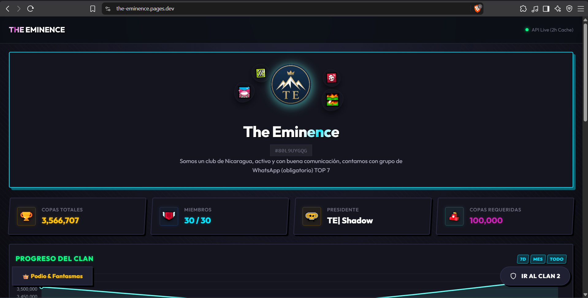 | 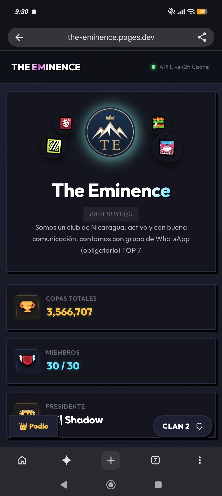 |

### 2. Trophy Progression & Member Roster
Interactive clan trophy evolution chart (`7D`, `Mes`, `Todo`) paired with live member search, trophy/name sorting, CSV export, and clan switching.

| Desktop View | Mobile View |
| :---: | :---: |
| 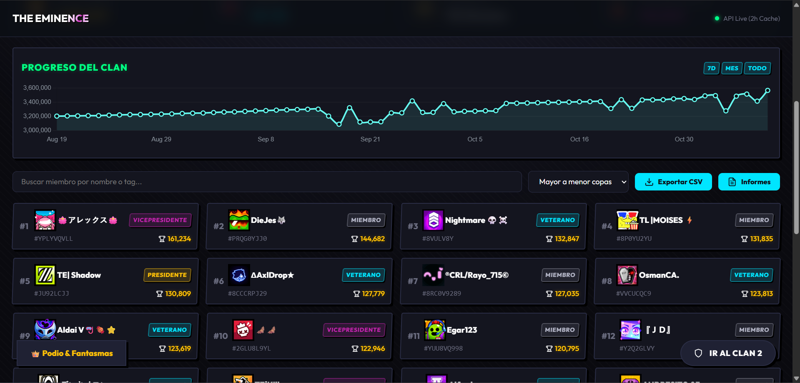 | 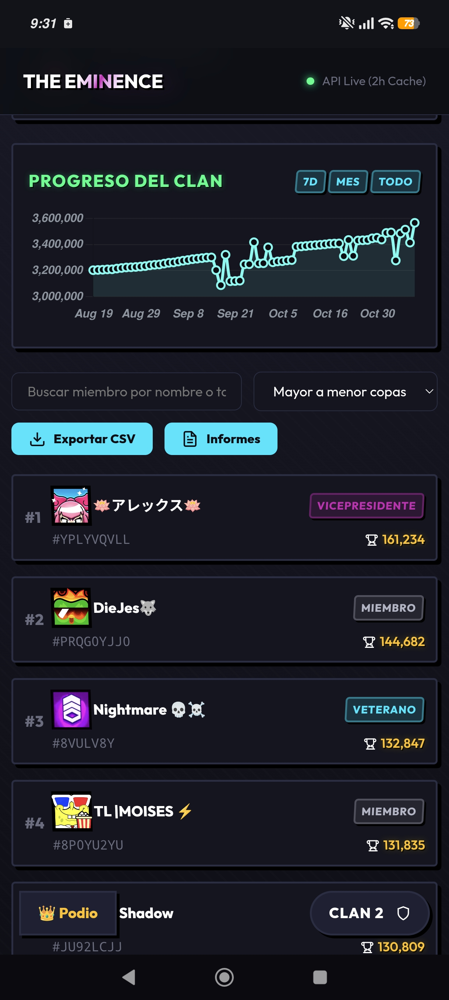 |

### 3. Player Profile & Stats
Detailed modal breakdown displaying current and record trophies, prestige metrics, Ranked tiers, Fame level, XP progression, and mode victories, with one-click graphic card export.

| Desktop View | Mobile View |
| :---: | :---: |
| 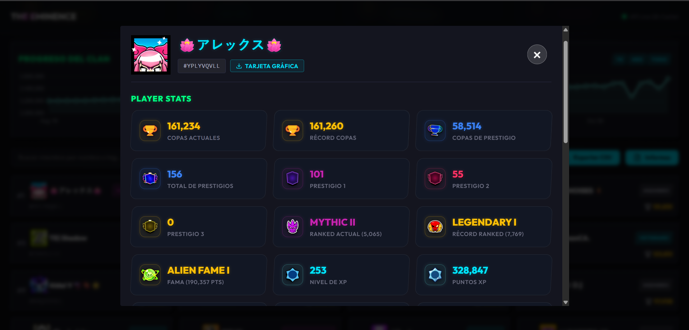 | 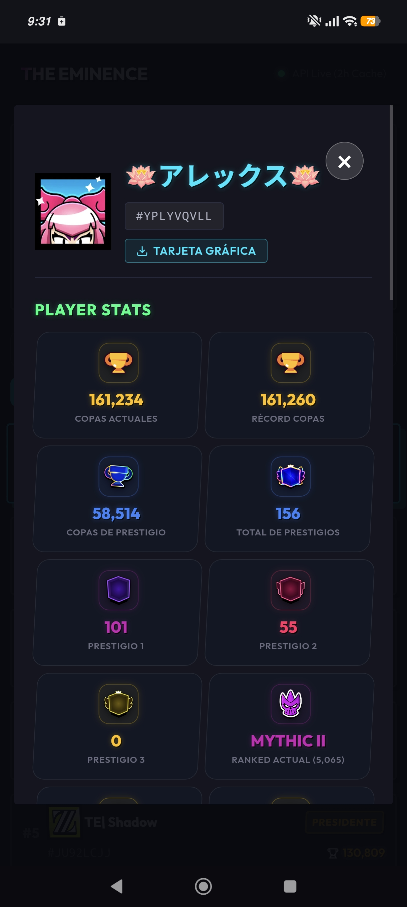 |

### 4. Player History, Progression & Top Brawlers
Individual trophy history graph with timeframe filters alongside unlocked Brawlers, Star Powers, Gadgets, Gears, Hypercharges, and Top Brawlers cards.

| Desktop View | Mobile View |
| :---: | :---: |
| 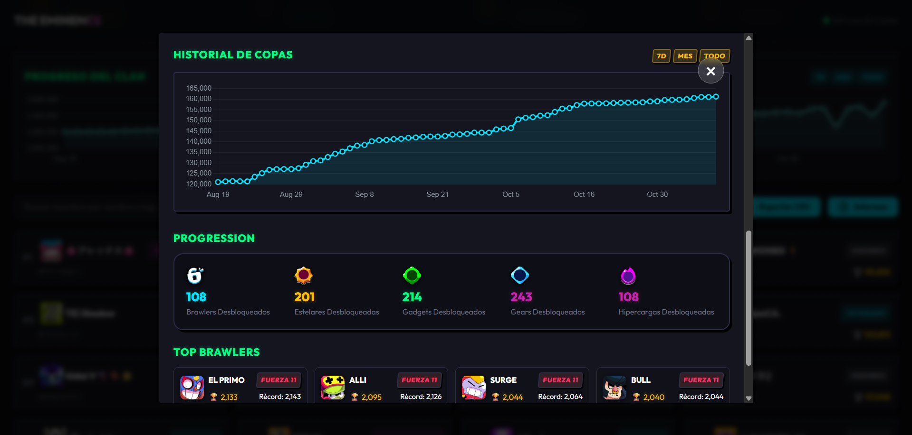 | 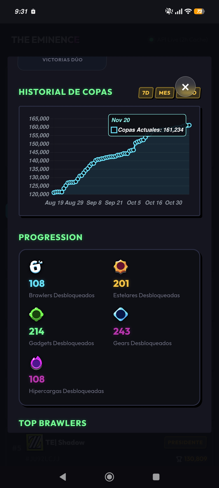 |

### 5. Weekly Winners Announcement
Celebration overlay highlighting the top weekly performers across Global, Clan 1, and Clan 2 scopes before entering the full leaderboard.

| Desktop View | Mobile View |
| :---: | :---: |
| 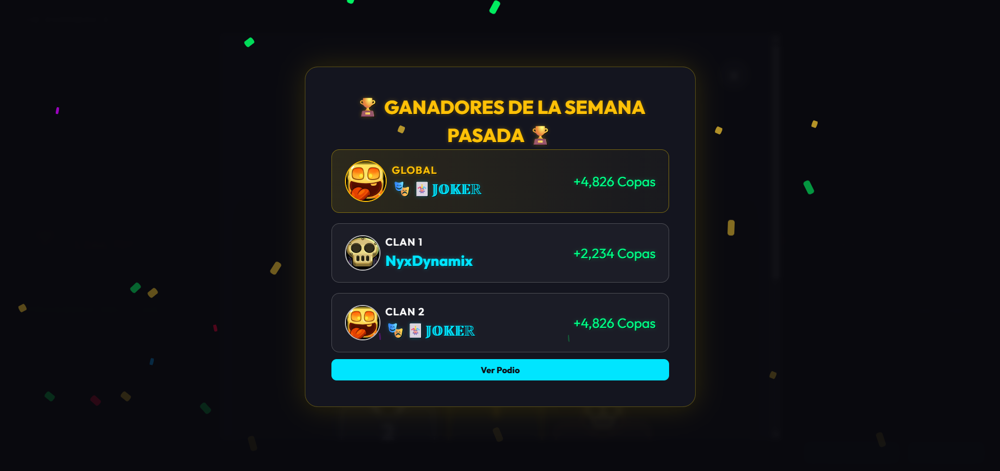 | 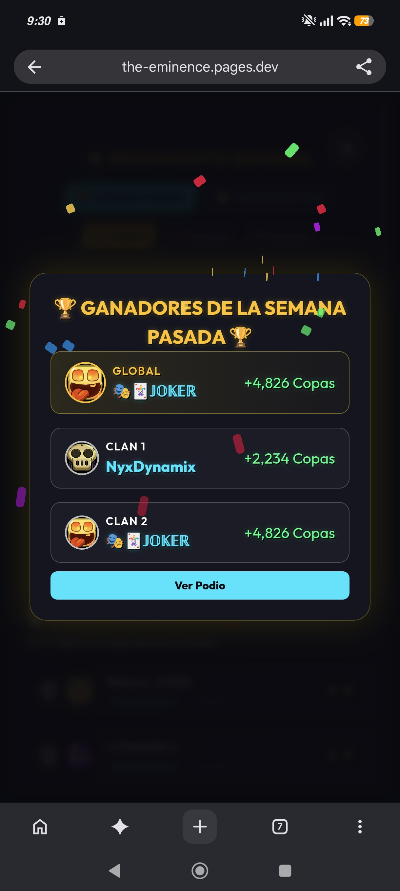 |

### 6. Weekly Podium (Hall of Fame)
Closed-week performance podium ranking the top three trophy pushers with scope filters (`Todos`, `Clan 1`, `Clan 2`) and period switching.

| Desktop View | Mobile View |
| :---: | :---: |
| 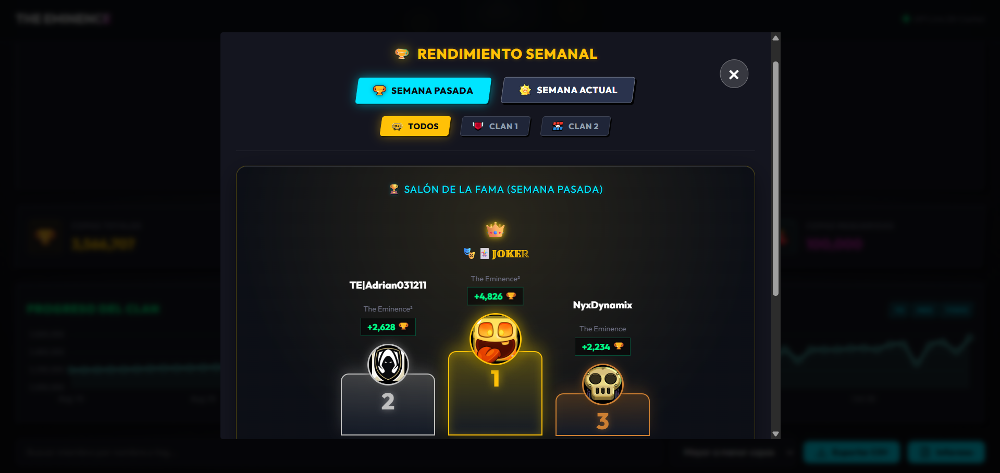 | 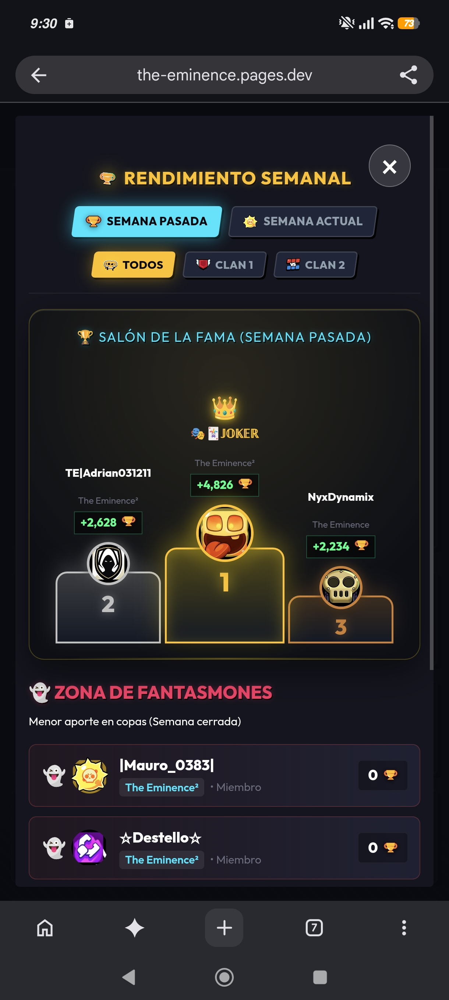 |

### 7. Current Cycle Leaders & Ghost Zone
Live tracking of the active weekly cycle leaders paired with the Ghost Zone (*Zona de Fantasmones*) to spotlight the lowest trophy contributions.

| Desktop View | Mobile View |
| :---: | :---: |
| 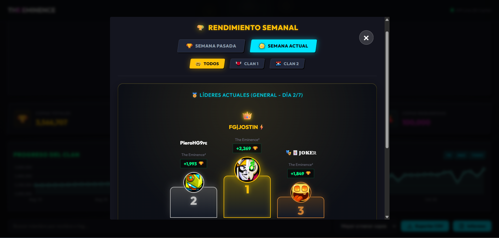<br><br>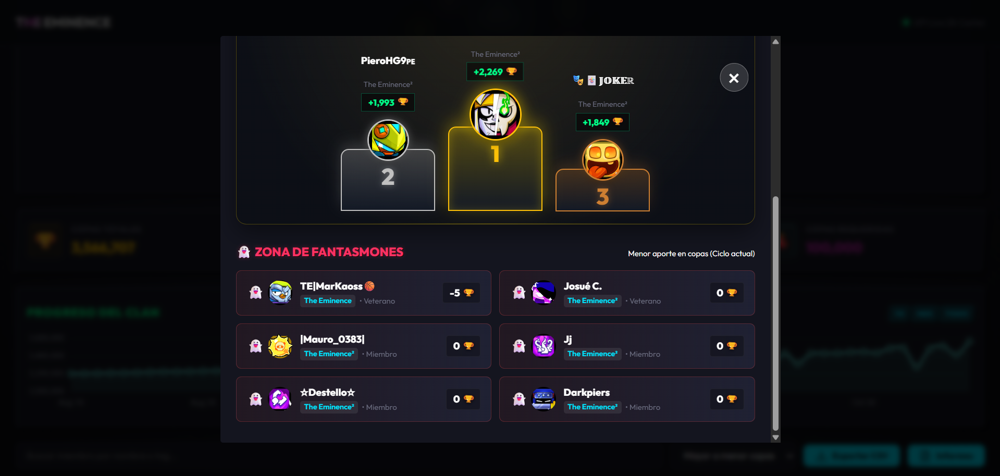 | 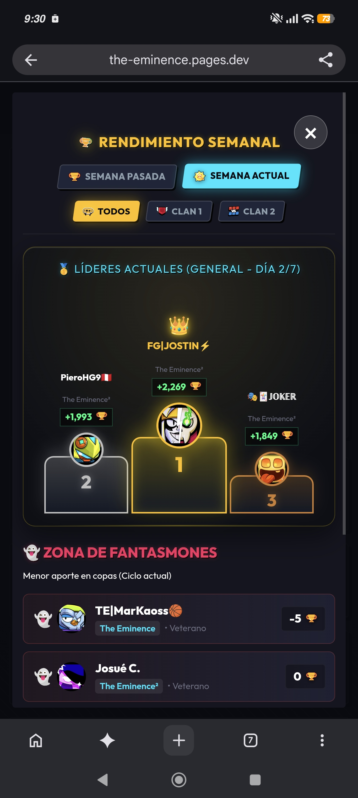 |

### 8. Clan Audit & PDF Reports
On-demand clan audit generator supporting weekly, monthly, and global historical ranges with net trophy balance, activity summary, top MVPs, member variation table, and multi-page PDF export.

| Desktop View | Mobile View |
| :---: | :---: |
| 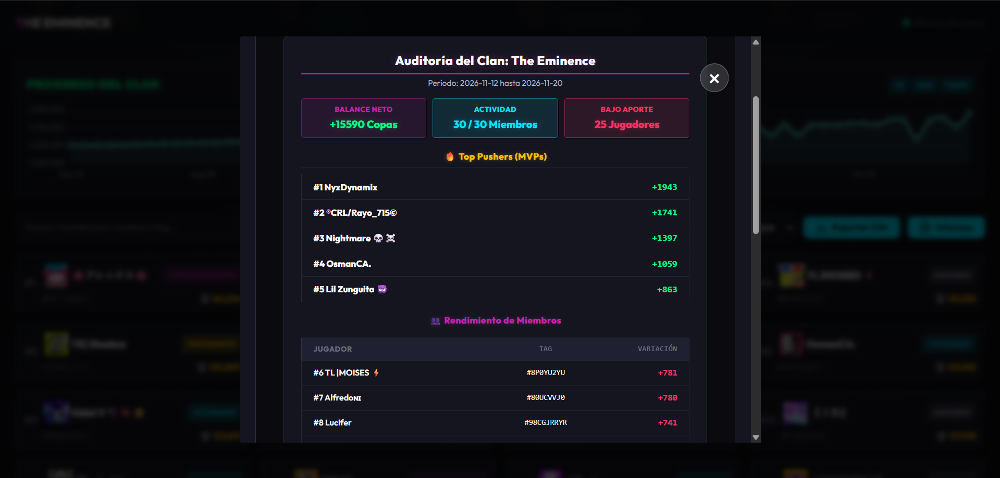 | 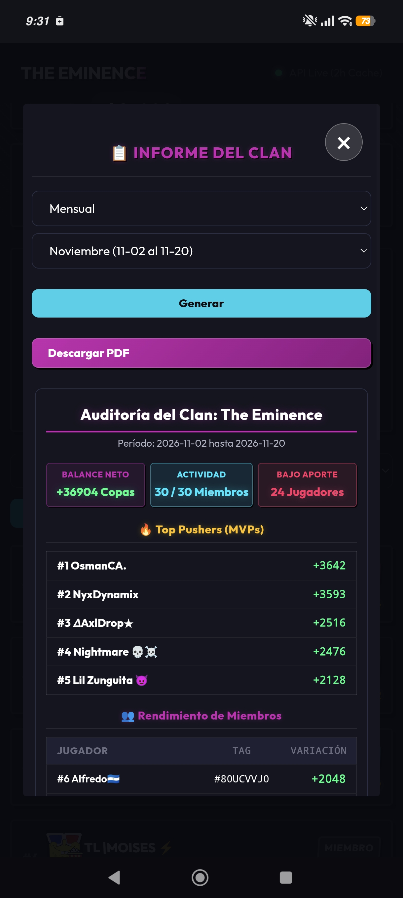 |

---

## Key Features

- **Serverless Edge & Historical Snapshots**: Cloudflare Pages Functions paired with a Cloudflare D1 database to proxy clan/player requests with caching and record historical trophy snapshots.
- **Interactive Evolution Charts**: Responsive line graphs powered by Chart.js with `7D`, `Mes`, and `Todo` filters for both clan-wide and individual player histories.
- **Multi-Clan Support**: Dedicated secondary clan view (`modules/Clan-2/`) sharing core services, charting, and reporting utilities across the clan family.
- **Weekly Podium & Ghost Zone**: Automated weekly cycle comparisons across Global, Clan 1, and Clan 2 scopes featuring a Top 3 Hall of Fame, winner announcement modal, and low-contribution tracking.
- **In-Browser Audit Reports & Exports**: Generate weekly, monthly, or global clan audits and export them as multi-page PDFs (`jsPDF` + `html2canvas`), roster CSV spreadsheets (UTF-8 BOM), or shareable PNG player stat cards.
- **Native Template Rendering**: Uses HTML `<template>` cloning for member cards, brawler grids, podium stands, and report rows to keep DOM updates clean and lightweight.
- **GPU-Friendly Visual Polish**: Hardware-accelerated animations (`transform` and `opacity` transitions), responsive grid layouts, and local asset icons for Ranked, Fame, Prestige, and game modes.
- **Zero-Account Access & Transparency**: Read-only public stats interface with no user logins or tracking cookies, complemented by a dedicated `legal.html` terms and privacy page.

---

## Tech Stack

- **Frontend Core**: HTML5, CSS3, and Vanilla JavaScript (ES Modules)
- **Serverless Backend**: Cloudflare Pages Functions
- **Database**: Cloudflare D1 (SQLite at the edge for historical clan and player snapshots)
- **Charts & Exports**: Chart.js, html2canvas, and jsPDF
- **DOM Engine**: Native `<template>` elements with modular service and utility classes
- **Styling**: CSS Custom Properties (`variables.css`), Flexbox/Grid layouts, responsive media queries, and keyframe animations
- **Typography**: Local `Outfit` font family (`Light`, `Regular`, `SemiBold`, `ExtraBold`)

---

## Project Structure

```text
The-Eminence/
├── index.html                      # Main clan tracker entry point and HTML templates
├── legal.html                      # Terms of service and privacy notice
├── README.md                       # Local project documentation and previews
├── docs/
│   └── assets/                     # Local desktop and mobile preview screenshots
├── styles/                         # Design tokens, layouts, icons, and fonts
│   ├── Fonts/                      # Local Outfit font files (.ttf)
│   ├── Icons/                      # Ranked, Fame, Prestige, and stat icons
│   ├── variables.css               # Color palette, borders, shadows, and font-face rules
│   ├── reset.css                   # Base cross-browser normalization
│   ├── layout.css                  # Responsive grids, modals, podium, and report styles
│   ├── utilities.css               # Reusable helper classes
│   └── animations.css              # GPU-composited podium and highlight animations
├── functions/                      # Serverless edge endpoints and D1 history queries
├── modules/
│   ├── core/
│   │   └── services/               # HTTP, clan, player, and history API services
│   ├── shared/
│   │   └── utils/                  # ChartManager, ReportManager, and formatters
│   └── Clan-2/                     # Secondary clan view and dedicated service
└── app/
    ├── app.js                      # Main application controller and UI lifecycle
    └── app.config.js               # Application configuration
```

---

## License

Copyright (c) 2026 Axel (Axel200514). All rights reserved.  
See [LICENSE](LICENSE) for full terms regarding proprietary source code, UI/UX design restrictions, liability disclaimer, and Supercell Fan Content Policy compliance.

